<a href="https://www.pntapps.com">
  <picture>
    <source media="(prefers-color-scheme: dark)" srcset="assets/banner-dark.svg">
    <source media="(prefers-color-scheme: light)" srcset="assets/banner-light.svg">
    
  </picture>
</a>

  
  
  

  <picture>
    <source media="(prefers-color-scheme: dark)" srcset="assets/typing-dark.svg">
    <source media="(prefers-color-scheme: light)" srcset="assets/typing-light.svg">
    
  </picture>

  <picture>
    <source media="(prefers-color-scheme: dark)" srcset="assets/wave-dark.svg">
    <source media="(prefers-color-scheme: light)" srcset="assets/wave-light.svg">
    
  </picture>

## 👋 Hi, we're PNT Apps

An independent app studio from India. We design, build and publish our own apps across **iOS, Android, macOS, Windows and the web**, and bring the same care to every client project. Technology should be easy, beautiful and genuinely helpful. That's the bar for everything we ship.

  <picture>
    <source media="(prefers-color-scheme: dark)" srcset="assets/wave-dark.svg">
    <source media="(prefers-color-scheme: light)" srcset="assets/wave-light.svg">
    
  </picture>

## 🧑‍💻 Founder

<table>
  <tr>
    <td width="190" align="center" valign="middle">
      
    </td>
    <td valign="top">
      <h3>Md Imran Ansari</h3>
      <b>Founder &amp; Lead Developer, PNT Apps</b>
        
      <i>"Every app we create is built with passion, attention to detail and a focus on making everyday life better."</i>
        
      
      
      
      
    </td>
  </tr>
</table>

  <picture>
    <source media="(prefers-color-scheme: dark)" srcset="assets/wave-dark.svg">
    <source media="(prefers-color-scheme: light)" srcset="assets/wave-light.svg">
    
  </picture>

## 🚀 Open source projects

<table>
  <tr>
    <td width="50%" valign="top">
      
      <h3><a href="https://github.com/pntapps/Veltoret">🎬 Veltoret</a></h3>
      Your movies and shows as a private cinema. Plays the videos in your Google Drive, on your device and on network shares, with posters and episode guides from TMDB.
        
      
      
      
      
      
      
    </td>
    <td width="50%" valign="top">
      
      <h3><a href="https://github.com/pntapps/plexichore">🖥️ PlexiChore</a></h3>
      Turn any Android tablet into a portable monitor for Windows and Mac. Extend, primary or mirror, over USB or Wi-Fi, with touch and S Pen input.
        
      
      
      
      
      
      
    </td>
  </tr>
  <tr>
    <td width="50%" valign="top">
      
      <h3><a href="https://github.com/pntapps/thrennix">⚡ Thrennix</a></h3>
      A very fast, simple download manager for Windows. Multi-connection engine, browser extension, pause and resume, plus video and YouTube downloads.
        
      
      
      
    </td>
    <td width="50%" valign="top">
      
      <h3><a href="https://github.com/pntapps/ek-chhoan">🏠 Ek Chhoan</a></h3>
      A calm, elder-friendly Android home screen. Big photos of family to call, big app buttons, a clear clock. English, Bengali and Hindi. No internet permission, fully private.
        
      
      
      
    </td>
  </tr>
</table>

<a href="https://www.pntapps.com/open-source">See every project on pntapps.com →</a>

All projects are free software under **GPL-3.0** with an attribution term. Issues and pull requests are welcome.

  <picture>
    <source media="(prefers-color-scheme: dark)" srcset="assets/wave-dark.svg">
    <source media="(prefers-color-scheme: light)" srcset="assets/wave-light.svg">
    
  </picture>

## 🛠️ What we build with

  
  
  
  
  
  
  
  
  
  

  <picture>
    <source media="(prefers-color-scheme: dark)" srcset="assets/wave-dark.svg">
    <source media="(prefers-color-scheme: light)" srcset="assets/wave-light.svg">
    
  </picture>

## 💼 Work with us

Have an app idea? We build **iOS and Android apps, React Native and Expo apps, web apps, AI features and ERP software** for clients worldwide. Tell us what you're planning and you'll get a clear plan, timeline and quote, usually within 24 hours.

  
  

